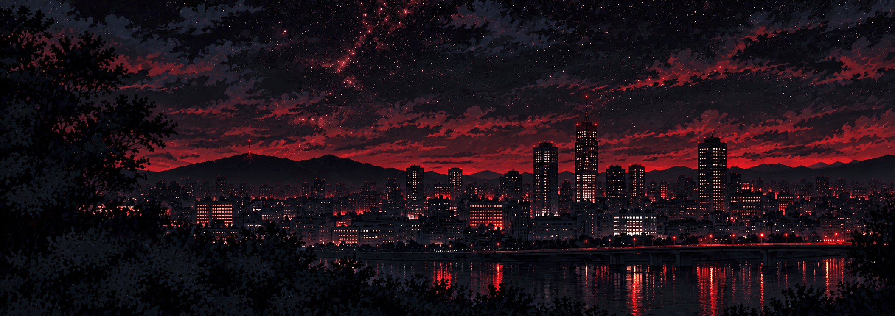
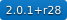
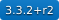
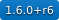

#  ppkantorski

<samp>💭 If it isn't broken, make it better.</samp>

 

---

##  Nintendo Switch Homebrew

### ☆ Ultrahand Ecosystem

<table>
<tr>
<td width="50%" valign="top">

###  [Ultrahand-Overlay](https://github.com/ppkantorski/Ultrahand-Overlay)  
The fully craft-able Nintendo Switch overlay executor; a versatile ecosystem with its own scripting language for custom package-based system management.

  
</td>
<td width="50%" valign="top">

###  [libultrahand](https://github.com/ppkantorski/libultrahand)  
Expanded libtesla + libultra libraries for Switch overlay development. The foundational C++ library powering Ultrahand and all compatible overlays.

  
</td>
</tr>
<tr>
<td width="50%" valign="top">

###  [nx-ovlloader](https://github.com/ppkantorski/nx-ovlloader)  
Host process for loading Nintendo Switch overlay OVLs. The core loader service of the Ultrahand ecosystem, with dynamic heap sizing and auto-relaunch support.

  
</td>
<td width="50%" valign="top">

###  [Ultrahand-Packages](https://github.com/ppkantorski/Ultrahand-Packages)
A comprehensive collection of known Ultrahand Overlay packages; the central hub for discovering and sharing community-built packages for the ecosystem.

  
</td>
</tr>
</table>

---

### ☆ Ultrahand Overlays

<table>
<tr>
<td width="50%" valign="top">

###  [UltraGB-Overlay](https://github.com/ppkantorski/UltraGB-Overlay)  
Game Boy / GBC emulation overlay for the Nintendo Switch; fully embedded overlay with customizable screen placement and controls.

  
</td>
<td width="50%" valign="top">

###  [Tetris-Overlay](https://github.com/ppkantorski/Tetris-Overlay)  
A fully playable Tetris game running as a Nintendo Switch overlay ¯\\\_(ツ)\_/¯

  
</td>
</tr>
<tr>
<td width="50%" valign="top">

###  [sys-tune](https://github.com/ppkantorski/sys-tune)  
Background audio player for the Nintendo Switch (libultrahand rebuild w/ improved design).

  
</td>
<td width="50%" valign="top">

###  [ovl-sysmodules](https://github.com/ppkantorski/ovl-sysmodules)  
Track system memory usage and toggle system modules on the fly.

  
</td>
</tr>
<tr>
<td width="50%" valign="top">

###  [sys-clk](https://github.com/ppkantorski/sys-clk)  
Overclock and underclock your Nintendo Switch CPU, GPU, and memory on a per-game and per-docked-state basis (rebuilt on libultrahand with HOC and EOS support).

  
</td>
<td width="50%" valign="top">

###  [Status-Monitor-Overlay](https://github.com/ppkantorski/Status-Monitor-Overlay)  
Real-time hardware monitoring overlay. Tracks CPU/GPU/RAM, temperatures, fan speed, frequencies, battery stats, charger info, and more (all on-device).

  
</td>
</tr>
<tr>
<td width="50%" valign="top">

###  [FPSLocker](https://github.com/ppkantorski/FPSLocker)  
Set custom display refresh rates and FPS targets in Nintendo Switch retail games, with per-game patch configs and advanced buffering controls.

  
</td>
<td width="50%" valign="top">

###  [ReverseNX-RT](https://github.com/ppkantorski/ReverseNX-RT)  
Alternative version of ReverseNX that can switch between handheld and docked mode in Real Time. (libultrahand rebuild)

  
</td>
</tr>
<tr>
<td width="50%" valign="top">

###  [Fizeau](https://github.com/ppkantorski/Fizeau)  
Color management overlay for the Nintendo Switch. Real-time adjust color temperature, saturation, hue, gamma, and contrast with scheduled dusk/dawn transitions.

  
</td>
<td width="50%" valign="top">

###  [QuickNTP](https://github.com/ppkantorski/QuickNTP)  
Instantly sync your Nintendo Switch system clock to NTP time servers via an Ultrahand overlay.

  
</td>
</tr>
<tr>
<td width="50%" valign="top">

###  [sysdvr-overlay](https://github.com/ppkantorski/sysdvr-overlay)  
About Overlay to check and change the current mode of SysDVR. (libultrahand rebuild)

  
</td>
<td width="50%" valign="top">

###  [NX-FanControl](https://github.com/ppkantorski/NX-FanControl)  
Control the fan curve of Nintendo Switch; rebuilt with libultrahand. (overlay only)

  
</td>
</tr>
</table>

---

### ☆ Ultrahand Packages

<table>
<tr>
<td width="50%" valign="top">

###  [HOC-Toolkit](https://github.com/ppkantorski/HOC-Toolkit)  
An Ultrahand package for advanced overclocking configuration on the Nintendo Switch, built specifically for Horizon OC. It provides a full interface for tuning RAM, CPU, GPU, and SoC parameters stored in the hoc.kip kernel patch directly.

  
</td>
<td width="50%" valign="top">

###  [Alchemist](https://github.com/ppkantorski/Alchemist)  
An Ultrahand package for managing, converting, and installing mods on the Nintendo Switch with support for exeFS patches, content mods, and pchtxt conversion.

  
</td>
</tr>
<tr>
<td width="50%" valign="top">

###  [Memory-Kit](https://github.com/ppkantorski/Memory-Kit)  
An Ultrahand package for manipulating various memory settings for Atmosphere and Ultrahand on the Nintendo Switch.

  
</td>
<td width="50%" valign="top">

</td>
</tr>
</table>

---

### ☆ Modding Tools

<table>
<tr>
<td width="50%" valign="top">

###  [7th-Heaven-NX](https://github.com/ppkantorski/7th-Heaven-NX)  
Install 7th Heaven / FFNx PC mods on Final Fantasy VII for Nintendo Switch; visual, audio, gameplay and engine improvements, packaged as a ready-to-copy SD card build.

  
</td>
<td width="50%" valign="top">

</td>
</tr>
</table>

---

